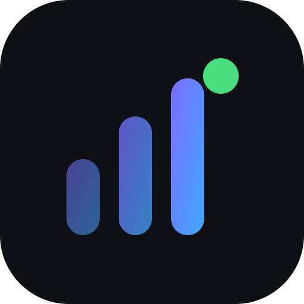
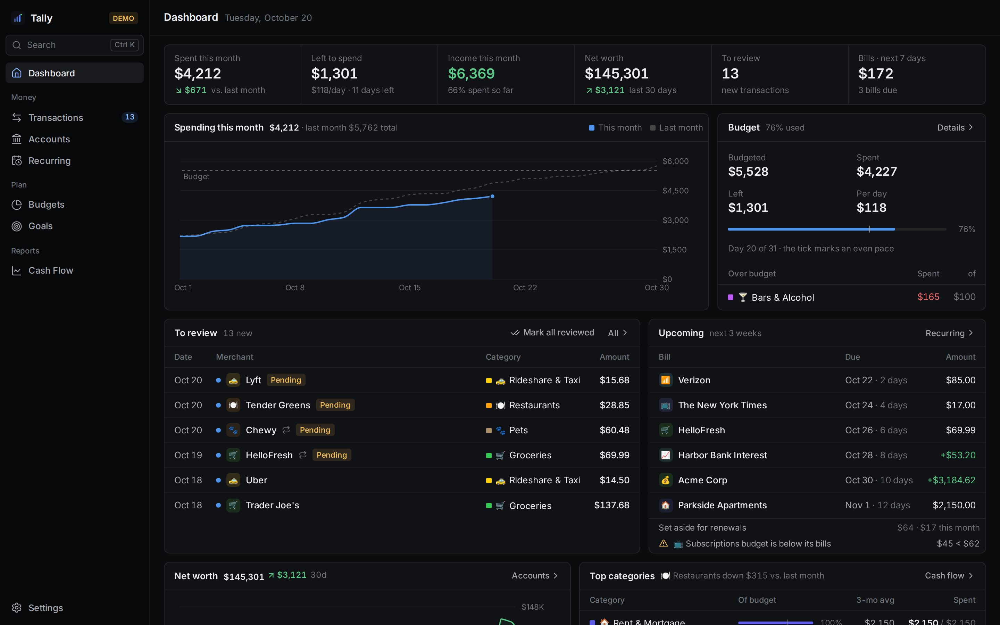
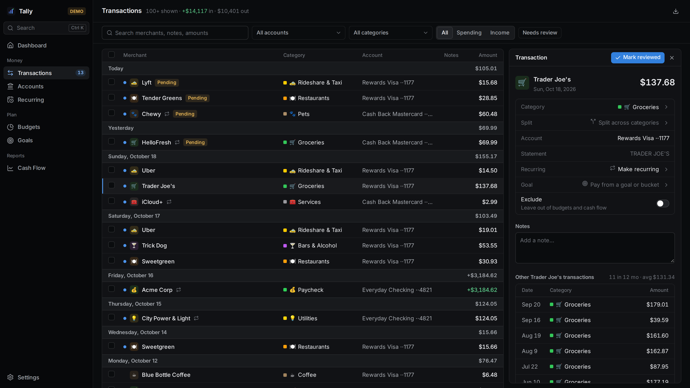
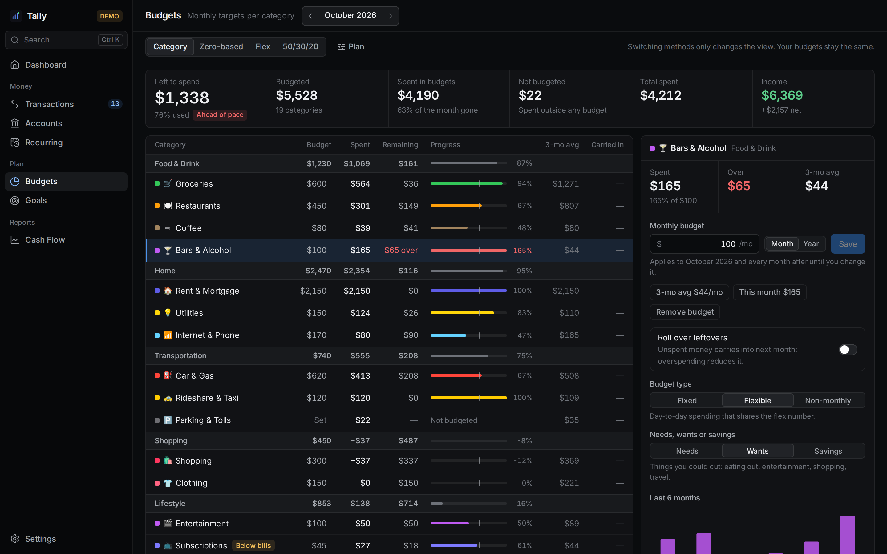
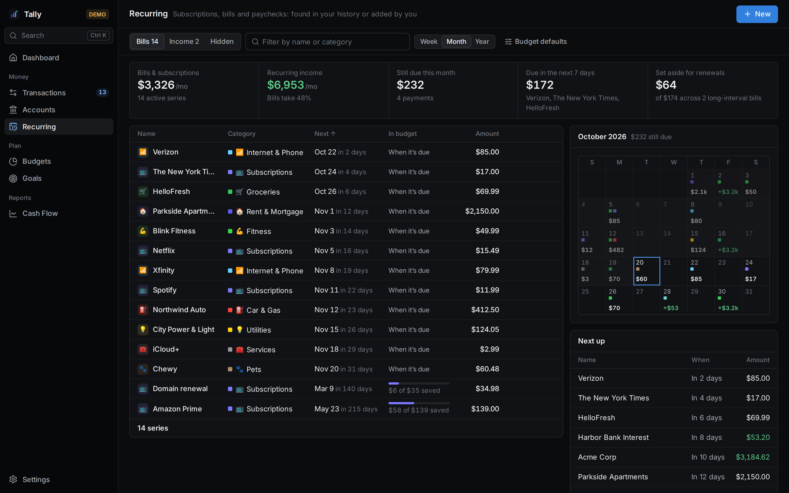
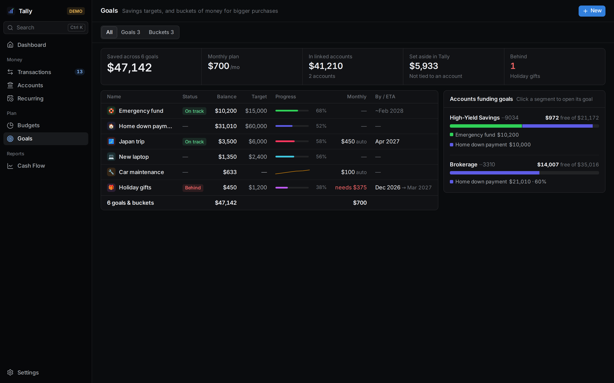
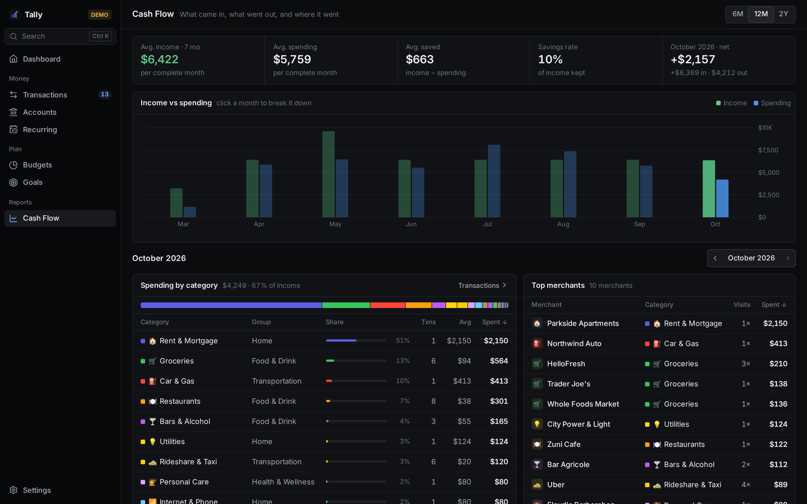
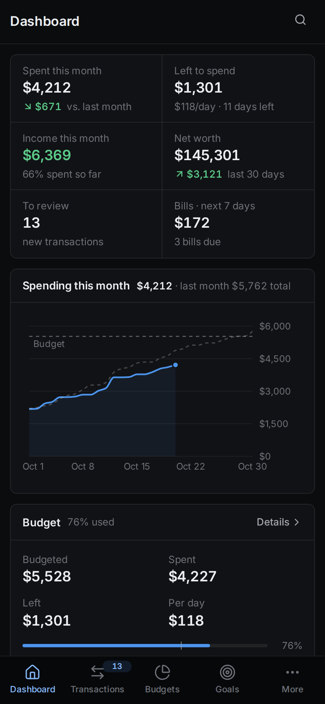
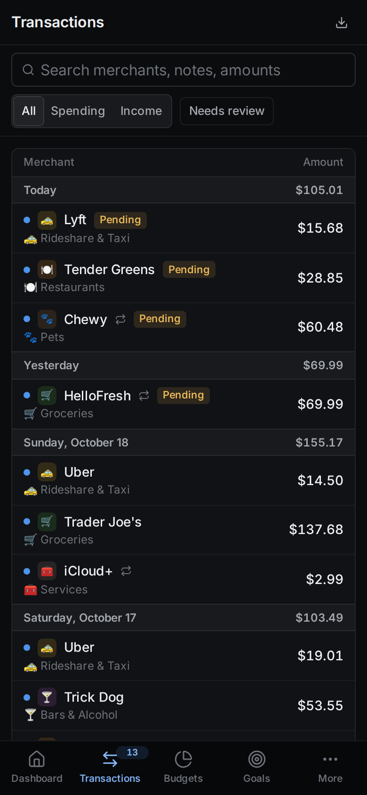
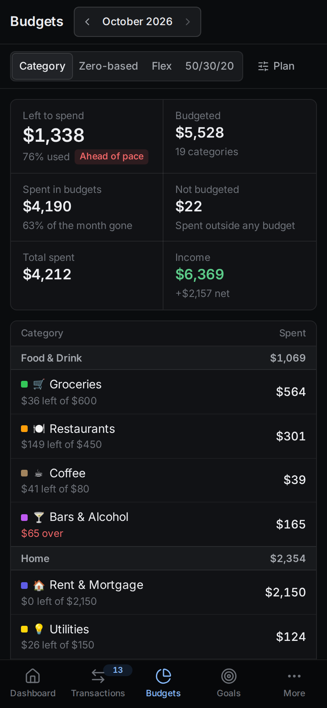

<div align="center">



# Tally

**A self-hosted personal finance app in the spirit of Copilot Money and Monarch.**
Bank sync through Plaid, budgets that understand your bills, goals, cash flow, and a dense, keyboard-friendly UI that works on desktop, iPad and phone.


[](LICENSE)
[](https://ko-fi.com/rc2k7)

[Features](#features) · [Screenshots](#on-your-phone) · [Quick start](#quick-start) · [Plaid](#connecting-banks-with-plaid) · [Architecture](#architecture) · [Operations](#operations) · [Support](#support)

<br>

<picture>
  <source media="(prefers-color-scheme: light)" srcset="docs/screenshots/dashboard-light.png">
  
</picture>

<sub>All screenshots use Tally's built-in demo data.</sub>

</div>

---

## Highlights

- 🏦 **Bank sync** with Plaid: incremental `/transactions/sync`, verified webhooks, on-demand refresh from the bank, and encrypted access tokens.
- 📊 **One budget, four methods.** Category, zero-based, Flex and 50/30/20 are views over the same numbers, so switching never loses anything.
- 🔁 **Recurring bills that feed the budget.** Detected or added by hand on any schedule. Each can count *when it's due* or *set aside monthly*.
- 🎯 **Goals and buckets** funded from real accounts, auto-contributions, or by paying a transaction from a goal.
- ✂️ **Splits, rules and review.** Split a charge across categories, auto-categorize with rules, and work through new transactions with `j`/`k`.
- 📱 **Installable PWA** with layouts tuned for phone, iPad and wide desktop screens. Dark, light or system theme, accent colours, density and a privacy blur.
- 🔐 **Passkey sign-in** only. No passwords, no third-party auth, and nothing leaves your server except calls to Plaid.

## Features

### Dashboard

Everything for the month on one screen: spending compared with last month and the budget, what's left per day, income, net worth, transactions waiting for review, bills due in the next three weeks, and the categories that moved.

### Transactions



- Grouped by day with daily totals, filters for account, category, direction and *Needs review*, and full-text search over merchants, notes and amounts.
- Opening a transaction docks it beside the table on wide screens. From there you can change the category, **split it** across several categories, turn it into a recurring series, pay it from a goal, exclude it from budgets, add notes, and see that merchant's history.
- Bulk select, keyboard navigation (`j`/`k`) and CSV export.
- Categorization runs in this order: your **rules**, then merchants Tally has learned from your edits, then Plaid's personal-finance category, then a fallback.

### Budgets



- Per-category monthly or yearly budgets with **rollover** and a **pace marker** that shows whether you're ahead of or behind the month.
- **Four methods over the same data**: *Category*, *Zero-based* (give every dollar a job), *Flex* (income − fixed bills − goals = one flexible number) and *50/30/20* (needs / wants / savings).
- Each category is *fixed*, *flexible* or *non-monthly* and can be tagged need, want or savings. That's what drives the Flex and 50/30/20 views.
- A category with no budget of its own is budgeted from its recurring bills, and Tally warns you when a budget is lower than the bills charged to it.

### Recurring bills and income



- Subscriptions, bills and paychecks are **detected from your history** or added by hand.
- Any schedule: every N days, weeks, months or years, twice a month, the last day of the month, with start and end dates and **your share** of a shared bill.
- Each series counts in the budget either **when it's due** (a weekly bill lands four or five times a month) or **set aside monthly** (an annual renewal fills a fund in time, catching up if you add it late).
- A month calendar, a *next up* list, and totals for what's still due this month.

### Goals and buckets



- **Targets** (an emergency fund, a down payment) with a date or an ETA, and **buckets** (car maintenance, gifts) that build up and get spent from.
- Fund a goal from **linked accounts** (in full, a fixed amount, or a percentage), from automatic monthly contributions, or with manual entries.
- Pay a transaction *from* a goal and it leaves your budget and comes out of the goal instead.
- Shows on-track and behind status, and what you'd need per month to catch up.

### Cash flow



Income against spending over 6 months, 12 months or 2 years, with average savings rate. Click a month to break it down by category, merchant and income source.

### Also included

- **Accounts and net worth** over time. Balance history is rebuilt backwards from transactions, so it's there from the day you connect.
- **Command palette** (`⌘K` / `Ctrl K` / `/`) to jump anywhere, search transactions and run actions.
- **Settings** for connections (with bank freshness: *bank updated* vs *last checked*), categories and groups, rules, appearance, security (passkeys and sessions) and data.
- **Demo mode**: *Explore with demo data* seeds seven months of realistic data. You can remove it from Settings → Data at any time.

## On your phone

<p align="center">
  
  &nbsp;
  
  &nbsp;
  
</p>

Install it from the browser as an app. Phones get a tab bar, tables that collapse into two-line rows, and full-height sheets. iPads get their own layouts in portrait and landscape.

## Quick start

Tally is self-contained: one app image, its own Postgres, and its own passkeys. All you need is Docker.

```sh
git clone https://github.com/Ruben-C/Tally.git && cd Tally
cp .env.example .env
sed -i "s/^POSTGRES_PASSWORD=$/POSTGRES_PASSWORD=$(openssl rand -hex 32)/; s/^TOKEN_ENC_KEY=$/TOKEN_ENC_KEY=$(openssl rand -hex 32)/" .env
mkdir -p data/app data/pg
docker compose up -d --build
docker compose exec -T tally node src/setup-code.js --hours 24
```

Open the printed link at **http://localhost:3000**, register a passkey, then choose **Explore with demo data** or connect a bank.

If your user id isn't 1000, set `PUID`/`PGID` in `.env` to the output of `id -u` / `id -g` so the containers can write to `./data`.

### Serving it on your own domain

Passkeys need HTTPS on any domain other than `localhost`, so put a reverse proxy (Caddy, nginx, Traefik, Cloudflare Tunnel, …) in front and point it at port 3000. Then set these in `.env` and run `docker compose up -d`:

```sh
RP_ID=money.example.com
ORIGIN=https://money.example.com
TALLY_BIND=127.0.0.1:3000   # default; use 3000 if the proxy runs on another machine
```

Set the domain before you register a passkey. Passkeys only work on the domain they were made for.

## Connecting banks with Plaid

1. Get keys from [dashboard.plaid.com](https://dashboard.plaid.com) → Developers → Keys and set `PLAID_CLIENT_ID`, `PLAID_SECRET` and `PLAID_ENV` (`sandbox` or `production`) in `.env`.
2. Run `docker compose up -d` again to recreate the container.
3. For OAuth banks (Chase, for example) in production, register `<ORIGIN>/plaid-oauth` as a redirect URI in Plaid and set `PLAID_REDIRECT_URI` to the same value.

Details:
- Sandbox test login in Plaid Link: `user_good` / `pass_good`.
- Access tokens are encrypted at rest with AES-256-GCM using `TOKEN_ENC_KEY`. Back that key up with your data, or stored connections can't be decrypted.
- Background sync runs every `SYNC_HOURS` (default 6, `0` turns it off). When `ORIGIN` is `https://`, Plaid webhooks to `/api/plaid/webhook` are used as well, and their JWTs are verified.

## Architecture

```
web/      React 19 + Vite + TypeScript PWA (TanStack Query, Recharts, react-plaid-link)
server/   Node 24 + Express 5 API, Postgres via pg, Plaid SDK, passkey auth
compose   tally (app) + db (Postgres 17 on a private network)
data/     app/ (auth state, audit log)  ·  pg/ (Postgres)
```

| Module | What it does |
| --- | --- |
| `server/src/plaid.js` | Link tokens, token exchange, `/transactions/sync`, refresh, verified webhooks |
| `server/src/categorize.js` | Rules → learned merchant → Plaid category → fallback |
| `server/src/recurring.js` | Recurring detection and payment matching |
| `server/src/schedule.js` | Schedule maths and how a series counts in a month's budget (when due / set aside) |
| `server/src/goals.js` | Goal balances, account allocations, auto contributions |
| `server/src/splits.js` | Split transactions (lines always add up to the bank amount) |
| `server/src/balances.js` | Balance history rebuilt backwards from transactions |
| `server/src/demo.js` | Demo data seeding and removal |
| `server/src/db/migrations/` | SQL migrations, applied in order at boot |
| `web/src/components/ui.tsx` | The shared UI kit (tables, panels, stats, inputs, sheets) every page is built from |
| `web/src/styles/app.css` | Design tokens: dark, light and system themes, accents, density |

**Money convention** (same as Plaid): `amount > 0` is money out, `< 0` is money in. Credit and loan balances are amounts owed.
All money totals go through one query base (`FLOW` in `server/src/routes/api.js`, reading the `txn_lines` view), which skips hidden accounts, excluded transactions and transfers, and expands splits.

## Operations

<details>
<summary><b>Updating</b></summary>

<br>

Pull the new version and rebuild. Database migrations run automatically at startup.

```sh
git pull
docker compose up -d --build
```

</details>

<details>
<summary><b>Sign-in links and passkeys</b></summary>

<br>

Tally has no passwords. To add a passkey (a new device, or after losing one), mint a one-time link:

```sh
docker compose exec -T tally node src/setup-code.js --hours 24          # add a passkey
docker compose exec -T tally node src/setup-code.js --hours 24 --reset  # remove all passkeys and sessions first
```

After `--reset`, restart the app (`docker compose restart tally`) before using the link.

</details>

<details>
<summary><b>Backups and moving hosts</b></summary>

<br>

Everything lives in `.env` and `data/`. To move, copy the whole directory to the new host and run `docker compose up -d --build`.
Or `pg_dump` from the `db` service and restore into any Postgres via `DATABASE_URL`.

- Keep `TOKEN_ENC_KEY`, or stored bank connections can't be decrypted.
- Passkeys are tied to the domain. If `RP_ID` changes, mint a new link with `--reset`.

</details>

<details>
<summary><b>Refreshing the screenshots</b></summary>

<br>

The images in `docs/screenshots/` come from a throwaway instance with demo data: a temporary `postgres:17-alpine`,
`node src/server.js` on `127.0.0.1` with `RP_ID=localhost` and a scratch `DATA_DIR` holding a pre-seeded session, `POST /api/demo`,
then Playwright at 1440×900 (2×) for desktop and 390×844 for phone. Never take them from real data.

</details>

## Support

Tally is free and open source, built and maintained in spare time. If it helps you keep track of your money, you can buy me a coffee. It keeps the project going.

<a href="https://ko-fi.com/rc2k7"></a>

Bug reports and ideas are just as welcome: open an issue.

## License

[MIT](LICENSE)
